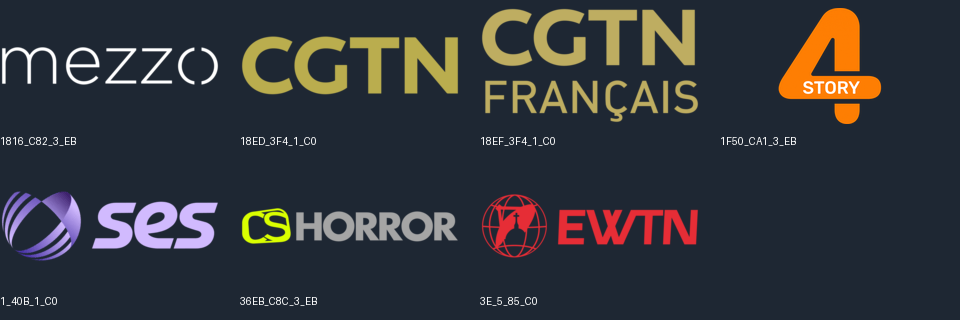
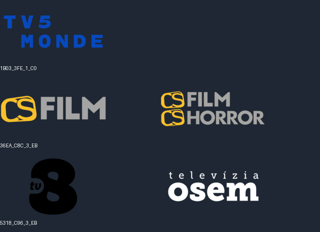
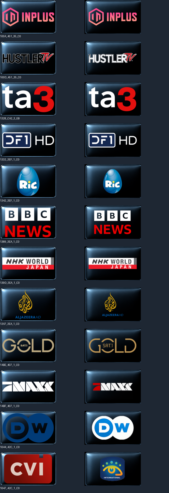

# Skylink a Canal+ SK/CZ — porovnanie skutočných balíkov

Stav po doplnení deviatich rádiových referencií do oboch Canal+ sád, 27. október 2026. Nemenný zdroj katalógu: `17ac58f68dc2016b161790781d6532d859f30c98`. Všetkých deväť porovnávaných ZIPov aj ich časti boli overené podľa veľkosti a SHA256. Audit nič neodstránil ani nezmenil v piconových balíkoch.

## Počty v spoločnom rozmere 220×132

| Balík | Transparent | Biele | Čierne |
|---|---:|---:|---:|
| Skylink | 257 | 257 | 257 |
| Canal+ SK | 238 | 238 | 240 |
| Canal+ CZ | 243 | 243 | 243 |

Počty sú PNG súbory, nie zaručené počty staníc. Po zlúčení technických aliasov má Skylink 255 identít služieb; Canal+ SK 234 (Transparent/Biele) alebo 236 (Čierne); Canal+ CZ 239. Referencie sa porovnávajú podľa SID, TSID, ONID a orbitálneho namespace, aby sa rozdiel typu služby SD/HD nepovažoval automaticky za ďalšiu stanicu.

Skylink obsahuje zmiešané slovenské aj české picony. Oproti Canal+ SK má 38 ďalších identít v Transparent/Biele a 36 v Čiernom; oproti Canal+ CZ ich má 33. Veľká časť týchto rozdielov je obsiahnutá v druhej krajinskej sade. Úplný výpis je v service-differences.csv a na obrázkoch `canalplus_sk-skylink-only-*` / `canalplus_cz-skylink-only-*`.

## Sedem referencií mimo spojenej množiny oboch Canal+ sád

| Identita v Skylinku | Nápis/značka na picone | Zistenie |
|---|---|---|
| 1816_C82_3_EB | Mezzo | Táto konkrétna referencia v Canal+ sadách nie je. |
| 18ED_3F4_1_C0 | CGTN | Rovnaký obrázok je v oboch Canal+ pod 164F_42C_1_C0. |
| 18EF_3F4_1_C0 | CGTN Français | Rovnaký obrázok je v oboch Canal+ pod 1651_42C_1_C0. |
| 1F50_CA1_3_EB | Story4 | Canal+ má značku Story4 aj pod 17EB_C82_3_EB, s inou grafikou. |
| 1_40B_1_C0 | SES | Logo SES; presný názov testovacej služby sa z obrázka nepotvrdzuje. |
| 36EB_C8C_3_EB | CS Horror | Samostatná stará referencia nie je v Canal+. Značka CS Horror je aj v spojenej picone CS Film/CS Horror na 36EA_C8C_3_EB. |
| 3E_5_85_C0 | EWTN | Rovnaký obrázok je v oboch Canal+ pod 3355_45B_1_C0. |

Sedem rozdielnych referencií preto nepredstavuje sedem preukázateľne chýbajúcich staníc. Tabuľka popisuje obsah obrázkov a súborov, nie dnešnú obchodnú ponuku ani stav satelitného vysielania.

## Zistené chyby a rozdiely grafiky

1. **TV5MONDE je v oboch Canal+ sadách chybná.** Transparentný PNG pre 1B03_3FE_1_C0 má celú alfu nulovú. Pixelová kontrola bieleho a čierneho prevedenia je presne zapísaná v named-findings.json; nejde o rozdielne oprávnenia stanice. Skylink má viditeľné logo.
2. **Canal+ SK nemá jednotné pokrytie farieb.** Canal+ Sport 2 (1F4B_CA1_3_EB) a Sport 1 (3C30_C90_3_EB) sú v Čiernom, ale chýbajú v Transparent/Biele. V Canal+ CZ sú vo všetkých troch prevedeniach.
3. **Rámčeky bielych a čiernych piconov sa výrazne odlišujú.** Pri testovaní štyroch rohov so schváleným MASTER podkladom sedí v Skylinku 251/257 čiernych a 252/257 bielych obrázkov. V Canal+ SK je to 29/240 a 21/238, v Canal+ CZ 28/243 a 22/243. Na kontrolovaných príkladoch majú mnohé Canal+ picony orezaný pravý/spodný rám. Nezhoda rohov sama osebe nie je dôkaz nesprávneho loga; presná metodika je v pixel-diagnostics.json.
4. **Pri spoločných transparentných referenciách sú rozdielne iba tri obrázky:** TV5MONDE, CS Film (Skylink má samostatné CS Film, Canal+ novšiu schválenú spoločnú CS Film/CS Horror) a TV8/televízia osem (Skylink má starú grafiku TV8, Canal+ aktuálny schválený obrázok osem). Tieto rozdiely sa nemajú mechanicky vracať na staré logá.

## Súbory a reprodukcia

- comparison.json: každá referencia a SHA256 pôvodného PNG aj viditeľných pixelov.
- pixel-diagnostics.json: prázdne PNG a rohy oproti schváleným MASTER podkladom.
- named-findings.json: konkrétne názvy prečítané z porovnávaných piconov a pixelová kontrola TV5MONDE.
- service-differences.csv: úplná prítomnosť identít vo všetkých deviatich ZIPoch.
- compare.py, details.py, pixel_diagnostics.py, write_report.py: reprodukcia nad nemenným verejným katalógom; Pillow je potrebný iba na počítači vykonávajúcom audit.

V tomto porovnaní sa žiadne staré stanice ani picony nevyraďovali. Chyby TV5MONDE, nejednotné farebné pokrytie dvoch športových staníc a rámčeky sú zaznamenané ako nálezy; audit ich nevydáva za už opravené.
