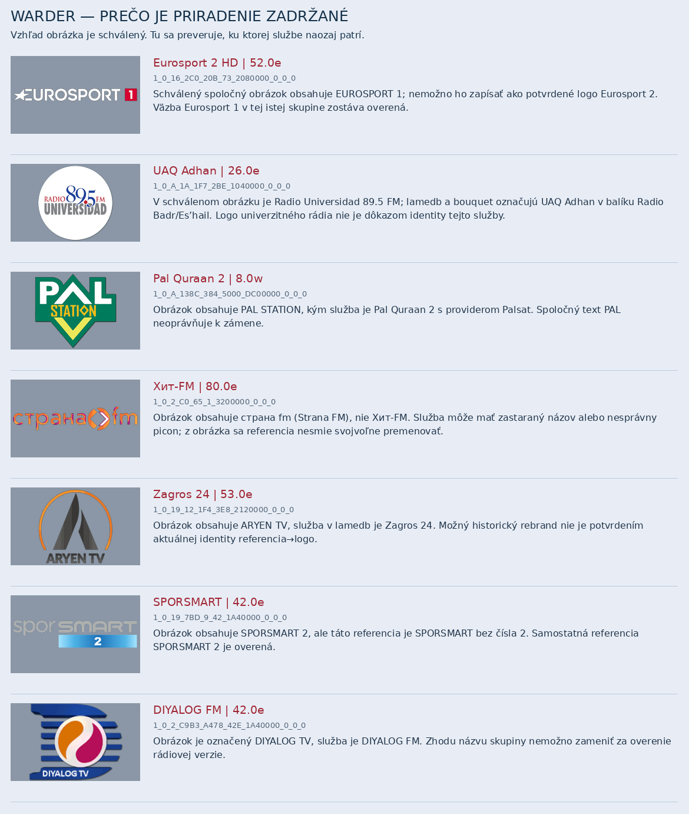
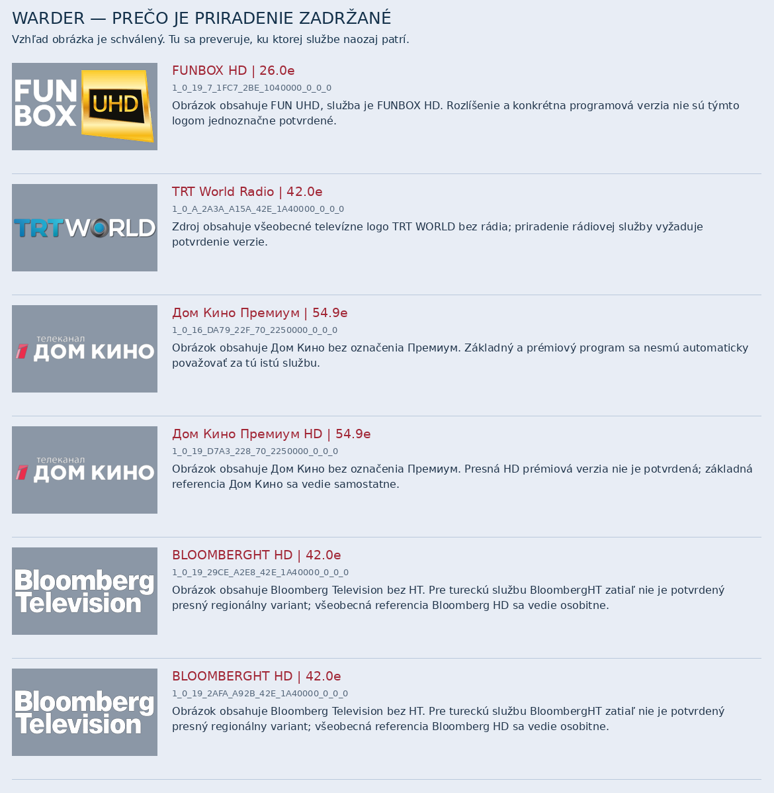

# Kontrola všetkých 809 referencií — dokončená

Preverených je všetkých 809 referencií z 622 schválených grafických skupín. Žiadna nezostala nespracovaná.

| Výsledok | Počet |
|---|---:|
| Overené priradenia pomenovaných programov | 661 |
| Technické/všeobecné služby — overená referencia | 135 |
| Rozpor alebo nepotvrdený variant identity loga | 13 |

Všetkých 809 plných referencií presne existuje v novembrovom lamedb, picon balíku aj bouquetoch. Sedí transpondér aj orbitálna pozícia. Typ služby bol v lamedb čítaný desiatkovo a v service reference zapisovaný hexadecimálne; namespace vrátane nízkych bitov sa nemenil. Západné pozície v transpondéroch sú znamienkové a pri porovnaní sa normalizujú modulo 3600, nie odstránením namespace.

807 schválených zdrojov pixelovo sedí s novembrovým piconom. Nova Sports 5 a 123.live zachovávajú konkrétny obrázok, ktorý presne sedí s rovnakou referenciou v našej databáze a už bol vlastníkom schválený.

Kontrola prítomnosti súboru nie je kontrolou loga. Všetkých 622 zdrojových grafík bolo navyše prejdených vizuálne oproti názvom služieb. Zachytené rozpory obsahuje `blocked-identity-conflicts.csv` s dôvodmi pri každej referencii. Rozpor nemení vlastníkom schválený vzhľad obrázka; blokuje jeho automatické priradenie nesprávnemu programu. Technické a generické názvy/obrázky sú samostatne v `technical-references.csv`, nie ako odhadnuté programové aliasy.

`verified-programme-mappings.csv` je konkrétny zoznam overených priradení pre túto novembrovú snímku. [Kompletný register](../../../plugin/artwork/provenance/warder-unchanged622-20261104/reference-verification.csv); presné surové záznamy lamedb, bouquety, transpondéry a kontrolné súčty obsahujú `references-*.json`. Kontrola nepredstiera aktuálny príjem zo satelitu ani overenie dnešného vysielania. Produkčné PNG a schválené grafiky zostali bez zmeny.

## Obrázkové dôvody zadržania

